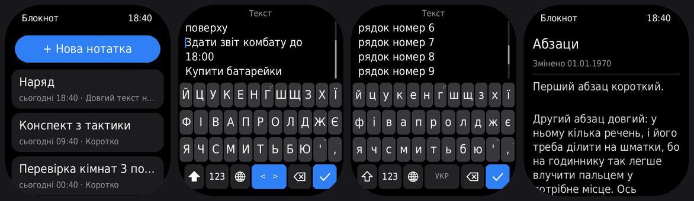

# Блокнот для Amazfit Bip 6

Нотатки прямо на годиннику: заголовок + текст, власна клавіатура УКР / ENG / 123. Усе зберігається на годиннику, телефон для роботи не потрібен.

## Встановлення через QR-код

1. У Zepp увімкни режим розробника: Профіль → Налаштування → «Детально» (Про застосунок) → 7 разів поспіль натисни на іконку Zepp.
2. Пристрій → Amazfit Bip 6 → самий низ сторінки → «Режим розробника» → кнопка сканування QR у правому верхньому куті.
3. Відскануй QR-код (показати його можна з іншого екрана):

   

   Посилання в QR-коді: `zpkd1://raw.githubusercontent.com/netherm3-coder/bip6-notes/build/bip6-notes.zpk`
4. «Блокнот» з'явиться в списку програм годинника.

QR завжди веде на останню збірку, тож для оновлення достатньо дочекатися зеленої галочки в Actions і відсканувати той самий QR ще раз. `appId` у `app.json` не змінюй: за ним годинник впізнає програму.

## Як це збирається

Після кожного пушу в `main` (і раз на добу) GitHub Actions збирає програму і кладе пакет у гілку `build`:

- `bip6-notes.zpk` — пакет для Bip 6, на нього вказує QR-код;
- `bip6-notes.zab` — повний пакет збірки.

Сканер «Режиму розробника» приймає лише preview-пакети (інакше Zepp пише «Only preview packages are supported»), тому після звичайного `zeus build` workflow збирає preview-пакет скриптом `.tools/build-preview.js` — без входу в Zepp і без завантаження на їхній сервер.

Збірку можна запустити й вручну: Actions → Build notes app → Run workflow. Репозиторій має бути публічним: Zepp завантажує пакет за прямим посиланням без входу в GitHub.

## Клавіатура

- Літера вводиться, коли **відпускаєш** палець. Поки тримаєш — над пальцем видно збільшену літеру; можна довести палець до сусідньої клавіші. Відвести палець угору на текст — скасувати.
- Довге натискання: **г → ґ**, **, → .**, **. → ?**, **' → "**. Маленька підказка в куті клавіші.
- **⇧** — велика літера, двічі швидко — Caps Lock. Після «. », «! », «? » і нового рядка велика літера вмикається сама.
- Два пробіли поспіль — крапка.
- **⌫** — стерти символ перед курсором, утримати — стерти слово перед курсором.
- **🌐** — УКР/ENG (вибір запам'ятовується), **123** — цифри й символи, там же **↵** — новий рядок (лише в тексті).
- **✓** — зберегти. Кнопка «Назад» на корпусі теж зберігає. Свайпи в редакторі вимкнено, щоб випадково не закрити його під час набору: палець по тексту гортає текст.

## Курсор і гортання

- **Затисни пробіл** (пів секунди) або одразу **поведи пальцем по пробілу вбік** — пробіл стане синім `<   >`, і вся клавіатура працює як тачпад: вліво-вправо — курсор по символах, вгору-вниз — по рядках. Відпустив — пробіл не ставиться. Звичайне коротке натискання, як і раніше, ставить пробіл.
- Друкувати й стирати можна будь-де: літери вставляються біля курсора, ⌫ стирає перед ним. Велика літера вмикається сама й посеред тексту — на початку речення чи рядка.
- **Текст гортається пальцем** угору-вниз (веди по тексту над клавіатурою); праворуч — смуга прокрутки. Видно 4 рядки.
- **Торкнись слова** — курсор стане туди. Почнеш друкувати після гортання — текст сам повернеться до курсора.
- **З перегляду:** торкнись абзацу (у довгому абзаці — речення) — редактор відкриється з курсором на його початку.

Ліміти: заголовок 80 символів, текст 4000. Коли до ліміту лишається 10 %, у заголовку редактора видно лічильник.

## Запасний шлях: QR із сервера Zepp

Якщо Zepp не прийме QR з GitHub — QR можна отримати через офіційний сервер Zepp (потрібен вхід у той самий акаунт, що в Zepp app):

1. Code → Codespaces → Create codespace on main (перший запуск 2–3 хв).
2. У терміналі `npm run qr`. Першого разу скрипт попросить увійти: відкрий посилання, увійди, скопіюй адресу зі сторінки помилки «localhost» і встав у термінал.
3. QR з'явиться в терміналі та у файлі `qr.png`. Він має термін дії (дата — над QR).

## Технічні нотатки

- Zepp OS 5 (API 4.0+), цілі збірки — лише Bip 6 (`deviceSource` 9765120, 9765121, 10158337), дизайн 390×450.
- Нотатки лежать у файлі `notes.json` у папці програми на годиннику; запис іде через тимчасовий файл, щоб збій посеред запису не зіпсував дані.
- Клавіатура вбудована в програму, а не системна: прошивка Bip 6 поки не має API для перевірки й увімкнення власної системної клавіатури.

## Структура

- `page/index.js` — список нотаток
- `page/view.js` — перегляд, редагування, видалення
- `page/edit.js` — редактор: курсор, гортання, дотик до тексту
- `utils/lines.js` — розбиття тексту на рядки екрана (кожен рядок — окремий віджет, тож відомо, де курсор); `utils/metrics.js` — ширини символів шрифту, міряються один раз і зберігаються в `metrics.json`
- `keyboard/` — клавіатура: розкладки, логіка тексту з курсором (`editor.js`), віджети й дотики, курсор пробілом
- `utils/store.js` — збереження в `notes.json` на годиннику
- `.github/workflows/build.yml` — збірка й публікація в гілку `build`
- `.tools/build-preview.js` — збірка preview-пакета для QR
- `.tools/` — також запасний шлях: `npm run qr` і вхід у Zepp для Codespaces (папка з крапкою, щоб Zeus не збирав ці скрипти для годинника)
